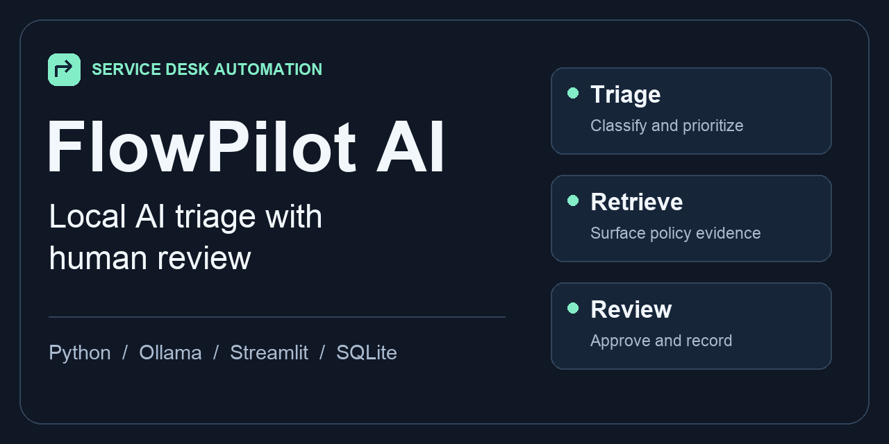
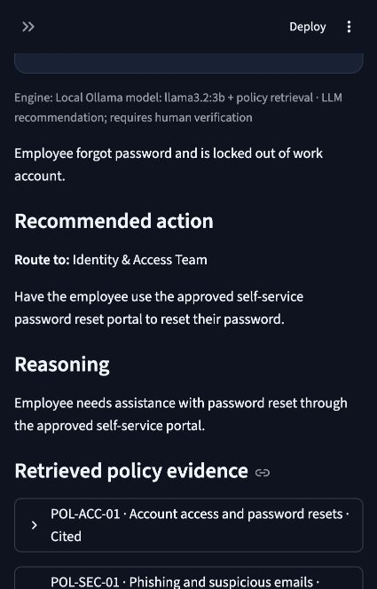
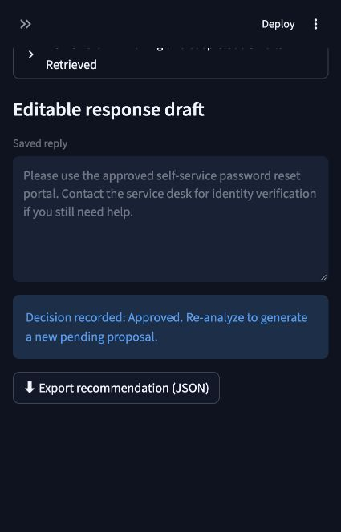
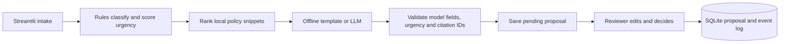

# FlowPilot AI

**A local AI workflow for IT service-desk triage.** Turn a raw ticket into a categorized, prioritized proposal with policy evidence, then edit the draft and record an approval or rejection in SQLite.

[Quick start](#run-it-on-your-mac) · [Architecture](#how-it-works) · [Evaluation](docs/EVALUATION.md) · [Raw results](docs/benchmark.json)

[](https://github.com/ahmedkashif232/flowpilot-ai/actions/workflows/checks.yml)

## What it looks like

| Policy-backed recommendation | Reviewed and approved |
| :---: | :---: |
|  |  |

## What the benchmark showed

| 24 synthetic tickets | Offline rules | Ollama · Llama 3.2 3B |
| --- | ---: | ---: |
| Category accuracy | 22/24 | 22/24 |
| Priority accuracy | 22/24 | 16/24 |
| Target policy in top three | 20/24 | 20/24 |
| Median analysis time | 0.4 ms | 4.88 s |

The model recovered an access issue the rules missed and underestimated the priority of all four billing cases. Both modes shared retrieval. These cases informed development, and the benchmark did not score draft quality. See the [case-level analysis](docs/EVALUATION.md).

## Run it on your Mac

Open [run_mac.command](run_mac.command) from Finder or run these commands in the project directory. Python 3.11 or 3.12 is recommended. The Mac verification used Python 3.9.6 with the pinned dependencies.

```sh
python3 -m venv .venv
source .venv/bin/activate
python -m pip install -r requirements.txt
python -m streamlit run app.py --server.address 127.0.0.1
```

The app starts with 12 fictional tickets. Choose **Offline rules** for an immediate demo. To use the local LLM, open [Ollama](https://ollama.com/download/mac), run `ollama pull llama3.2:3b`, and choose **Local Ollama** in the sidebar. The sidebar checks whether the configured model is installed. The model download is about 2 GB.

Try **REQ-001** for account recovery or **REQ-005** for a phishing incident. Analyze the ticket, open the policy evidence, edit the reply, and click **Approve proposal**. The **Audit trail** shows the recommendation and decision. Re-analysis creates a fresh pending proposal. CSV import accepts up to 100 records with `subject`, `description`, and optional `requester` columns.

## How it works



| Component | Responsibility |
| --- | --- |
| `app.py` | Inbox and status filter, manual and CSV intake, recommendation review, evaluation, analytics and audit views |
| `flowpilot/agent.py` | Keyword baseline, prompt and response schema, output validation, owner mapping, priority floors, fallback |
| `flowpilot/policies.py` | BM25-style lexical ranking over 12 fictional policy passages with a small boost for the rule-predicted category |
| `flowpilot/ollama.py` | Local model discovery and schema-constrained HTTP calls to Ollama on loopback |
| `flowpilot/storage.py` | SQLite transactions, atomic batch import, review revision checks, and audit events |
| `flowpilot/evaluation.py` | Shared evaluation pipeline, CLI, per-case results, and fallback-aware scores |

Ollama receives the subject, description, and up to three snippets. The structured output contract defines category, priority, summary, rationale, action, reply, and citation IDs. Python checks the returned shape and filters citations to the retrieved IDs. It applies deterministic security routing and High/Critical priority floors where the rules trigger. If the provider fails, the dashboard labels the offline fallback. Citation validation establishes that the ID was in the retrieved context. A reviewer still checks whether the cited text supports the claim.

The review form submits the edit and decision together. SQLite updates a pending proposal only if the displayed revision matches, and inserts its audit event in the same transaction. The database retains the latest proposal per request and recent event metadata. Re-analysis replaces the previous proposal body.

## Test and evaluate

```sh
python -m unittest discover -s tests -v
python demo_cli.py --ticket REQ-005 --engine ollama
python -m flowpilot.evaluation --engine both --output benchmark.json
```

Use `--engine offline` for a model-free evaluation. The **Evaluation** tab can display the recorded Mac run or start a new comparison. [Mac results](docs/benchmark.json) include per-case predictions, policy IDs, model digest, fixture hashes, fallback counts, and timings. See [the evaluation notes](docs/EVALUATION.md) for results and limitations. [GitHub Actions](.github/workflows/checks.yml) is configured to run the model-free tests and offline evaluation on push and pull request.

## Configuration and scope

- `FLOWPILOT_DB` overrides `data/flowpilot.db`. The local database, virtual environment, and secrets are gitignored. The sample dataset is seeded on an empty database.
- `OLLAMA_MODEL` overrides `llama3.2:3b`. The model must be installed in the local Ollama instance.
- The existing optional **OpenAI API** path requires `OPENAI_API_KEY` and supports `OPENAI_MODEL` (default `gpt-4.1-mini`). This sends ticket text and retrieved snippets to the API. Live API calls were outside the Mac verification.

Use synthetic tickets. This is a single-machine portfolio project with simulated approvals. The reviewer label is a demo label, and the SQLite event log is editable by anyone with database access. An operational deployment would need authenticated reviewer identities, data retention and access controls, and reviewed integrations before enabling external actions.
